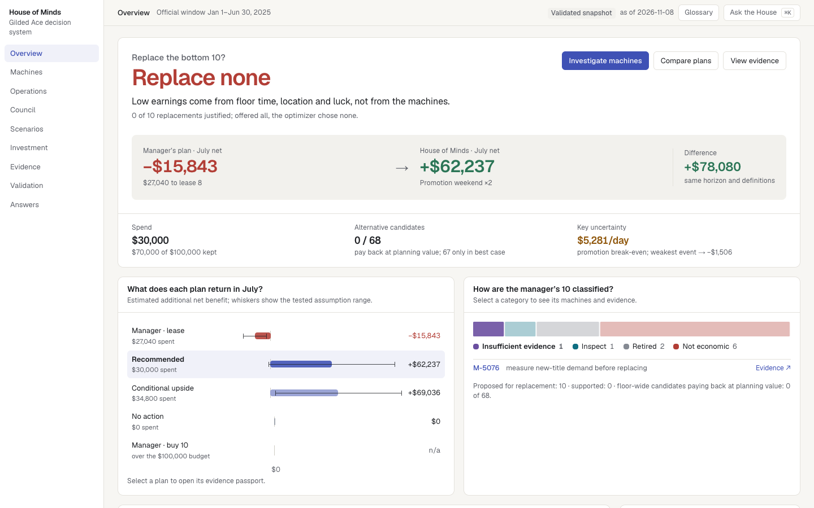
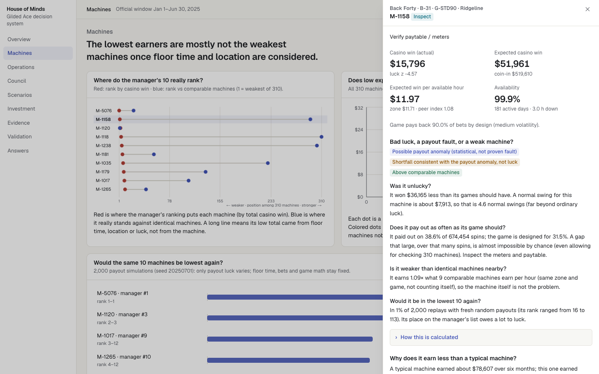
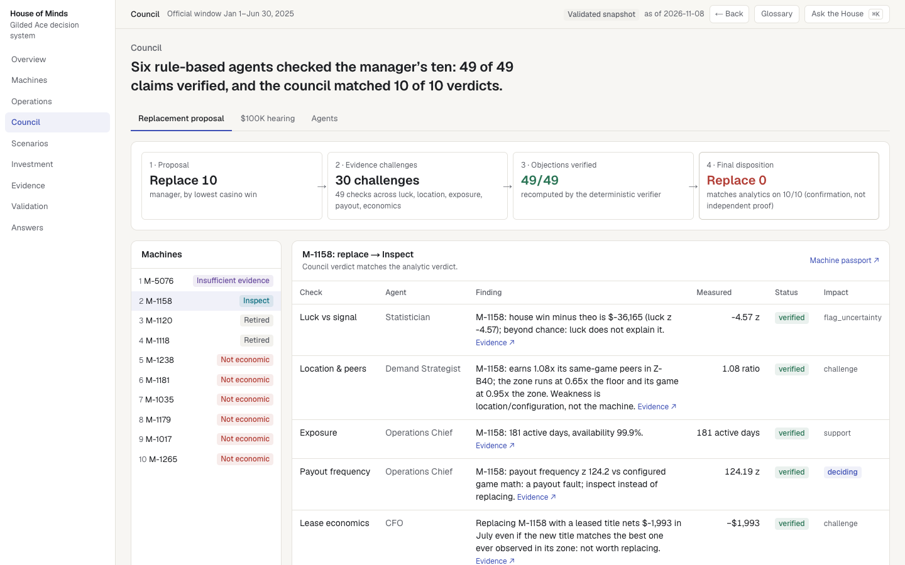
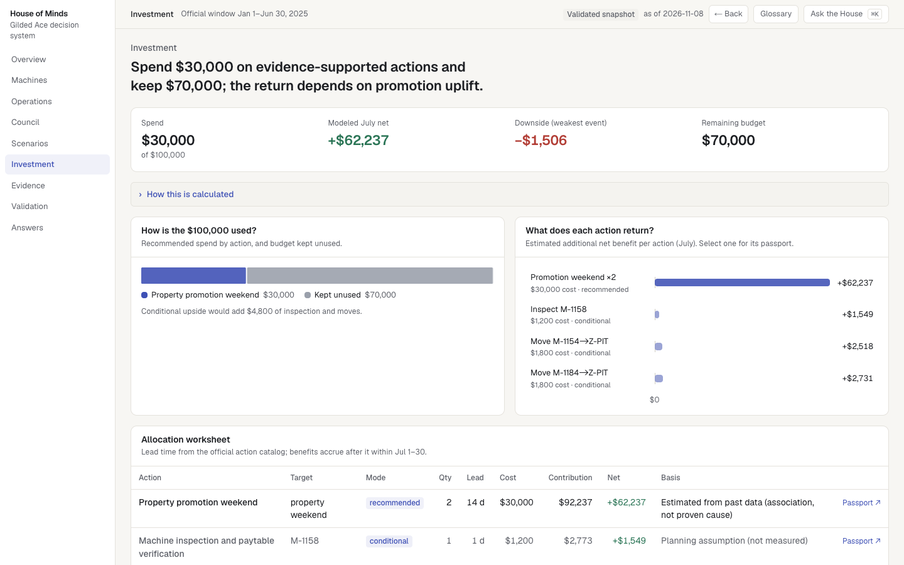
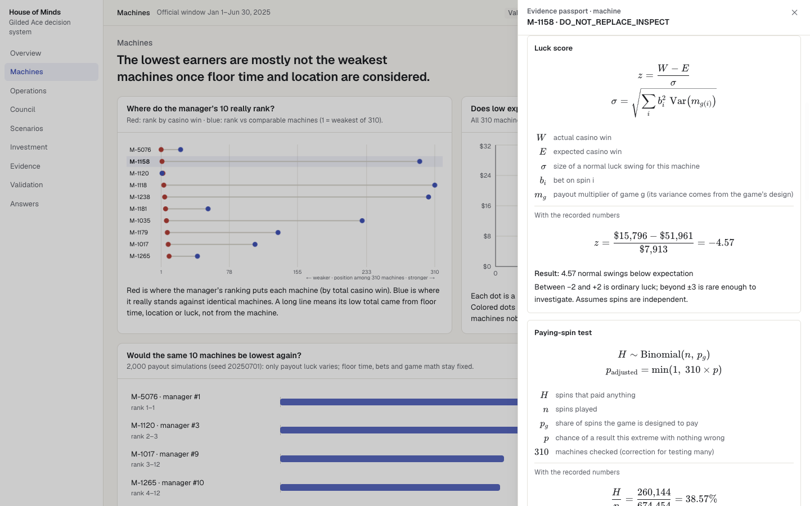
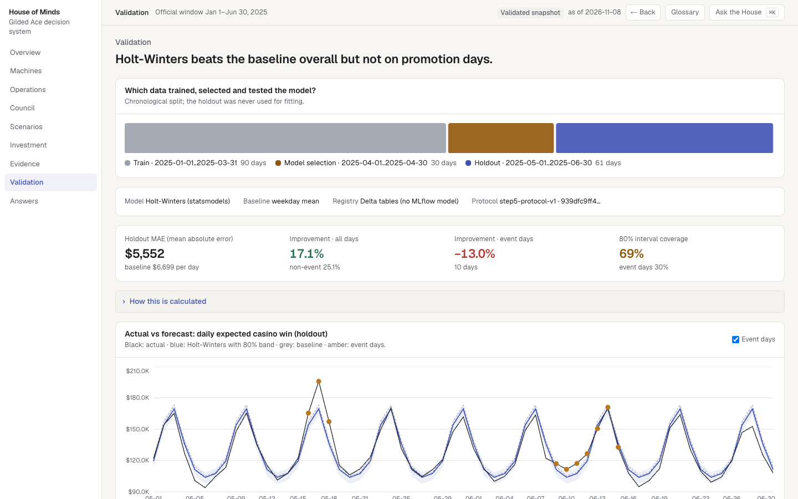
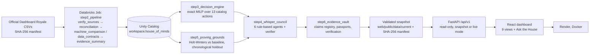

# House of Minds

**Evidence-driven casino decision intelligence**

House of Minds answers one management question for The Gilded Ace casino: *should we replace our ten lowest-earning slot machines?* It builds the analysis on Databricks: reconciled tables in Unity Catalog, statistical forensics, a validated forecast and an exact budget optimizer. Six rule-based specialist agents then challenge every finding, and a dashboard lets a manager trace each number back to the table and query behind it.

**Live dashboard:** https://house-of-minds.onrender.com (no account needed; the free host can take about a minute to wake)
**Challenge:** TAMU Datathon 2026 · Dashboard Royale ([guide](https://github.com/tamu-datathon-org/dashboard-royale/blob/main/GUIDE.md))
**Data window:** January 1 – June 30, 2025 (181 gaming days, 6 a.m. to 6 a.m.) · **Decision horizon:** July 1–30, 2025 · **Budget:** $100,000, at most three action types
**Stack:** Databricks (Unity Catalog, serverless Jobs, SQL warehouse) · Python 3.12 · statsmodels · FastAPI · React 19 / Next.js static export · KaTeX · Render (Docker)

---

## The decision

**The manager's proposal:** replace the ten machines with the lowest casino win.

**What the analysis found:** none of the ten should be replaced. A low total is not the same thing as a weak machine.

| Of the manager's ten | Finding |
|---|---|
| 2 | Already retired (M-1120, M-1118), so they cannot be replaced |
| 1 | M-1158 pays out on 38.6% of spins against a designed 31.5% (z = 124 over 674,454 spins). Inspect it rather than replace it |
| 6 | A new lease loses money in July even if the new title matched the zone's best machine |
| 1 | M-5076 was on the floor only 49 days, too short to judge |

All ten council reviews agree with these verdicts. Most of the ten stand in Back Forty, the weakest zone. A walkway closure cut demand there by about 31%, and several of the ten run low-edge games. Their low totals come mainly from location, floor time and payout luck, not from the machines themselves.

**July plan (evidence-supported):** two property promotion weekends.

| Plan | Cost | Modeled July net | Range across tested assumptions |
|---|---:|---:|---:|
| **Recommended: 2 promotion weekends** | $30,000 | **+$62,237** | −$1,506 to +$125,981 |
| Manager's proposal (lease 8 replacements) | $27,040 | −$15,843 | −$27,399 to −$4,287 |
| Conditional: adds the M-1158 inspection and two machine moves | $34,800 | +$69,036 | +$5,292 to +$132,780 |

$70,000 stays unspent. The conditional plan depends on effects nobody has measured yet (whether the inspection fixes M-1158, and whether demand follows a moved machine), so it is shown but not recommended.

**Main uncertainty:** the promotion pays only if each promotion day adds at least **$5,281** of expected casino win. Across the two past promotion events, the estimated uplift was $5,016 per day for the weakest event and $27,458 for the strongest, an average of $16,237. That evidence is associational: two events and no control group. At the weakest event's uplift the plan would net −$1,506.

**How success is measured:** each action has a measurement plan with a stop rule (`MP-A-PROMO` and others; see [Financial decisions](docs/FINANCIAL_DECISIONS.md)).

## Screenshots

| | |
|---|---|
|  |  |
| **Overview.** Verdict, the ten machines, July plan | **Machines.** One machine, four statistical questions |
|  |  |
| **Council.** Six rule-based reviewers, every check visible | **Investment.** Budget use, action economics, risk |
|  |  |
| **Evidence passport.** Formula, symbols, real values, meaning | **Validation.** Chronological holdout against a baseline |

## What makes it different

- **Fair comparisons.** Machines are ranked on expected casino win per *available* hour against comparable machines (same game, same zone, leaving the machine itself out). Raw totals are not used.
- **Luck kept apart from performance.** Each machine gets a luck score, an exact paying-spin test corrected for checking 310 machines, and 2,000 luck-only replays of the six months.
- **A gap breakdown that adds up exactly.** Each machine's gap to a typical machine splits into luck, exposure, location, game and the machine itself.
- **A council that can change the answer.** Six rule-based specialists check every claim. A deterministic verifier and a "Whisper Network" retract claims that fail. One false causal claim was retracted this way.
- **Evidence passports.** Every recommendation and machine verdict opens to its formula, the recorded numbers, the source tables, the alternative explanation and the limitation.
- **Ask the House.** A deterministic question router answers from the same API. It names its evidence, and it refuses or flags questions it cannot support. It makes no LLM calls.

## Architecture



- **Batch.** The Databricks jobs run on demand (`databricks bundle run`). None is scheduled.
- **Snapshot.** `scripts/export_web_snapshot.py` writes the validated tables, with a SHA-256 manifest, into `web/public/data/current/`. The Docker image bundles that snapshot, so the public site shows a fixed, validated snapshot (`chf-v1:bc5e8ccc5d88a490`). Changing it needs a new export and a redeploy, which happens automatically on push to `main`.
- **Live mode.** `HOM_DATA_MODE=databricks` makes the same API read the Unity Catalog tables through an allowlist. The public site does not use it.

More detail: [Architecture and lineage](docs/EVIDENCE_AND_LINEAGE.md) · [Databricks engineering](docs/DATABRICKS.md) · [Data contract](docs/DASHBOARD_DATA_CONTRACT.md)

## Analytical methods

All formulas, with their symbols, real values and plain-English meaning, are in **[Analytical methods](docs/ANALYTICAL_METHODS.md)**. The essentials:

- **Casino win** = amount wagered − prizes paid. Over six months: $248,905,219 − $225,267,064 = **$23,638,155**.
- **Share of wagers kept (hold)** = total casino win ÷ total wagered = **9.50%**. The totals are added up first and divided once.
- **Expected casino win** = amount wagered × (1 − game payout rate) = **$23,545,365**. This is the luck-free measure of play.
- **Luck score** z = (actual win − expected win) ÷ normal luck swing. For M-1158: ($15,796 − $51,961) ÷ $7,913 = **−4.57**.
- **Forecast:** Holt-Winters missed by **$5,552** per day on average on the untouched May–June holdout. The weekday-average baseline missed by $6,699, so the model's average miss is **17.1%** smaller.

## The six-agent council

| Agent | Question it checks |
|---|---|
| Statistician | Is it luck or signal? (multiple-testing control) |
| Demand Strategist | Is it the location, foot traffic or game rather than the machine? |
| Operations Chief | Was it on the floor long enough? Is downtime or a payout fault involved? |
| Guest Analyst | What does tracked-player behavior show (in aggregate only)? |
| Loyalty Strategist | What do comps cost, and how have points economics changed? |
| CFO | Does it pay in July, within budget, and what is the regret? |

The agents are **deterministic rule-based analyses** over allowlisted read-only tools. They are not generative AI. The product makes no LLM calls: 0 tokens, $0. See [Council and decision logic](docs/COUNCIL_AND_DECISION_LOGIC.md).

## Four judge interactions

1. **Change the analysis period.** Open Operations → Demand and set the date range. The KPIs, calendar, weekly chart and "What changed" cards recalculate for that range. This is exploratory only: it does not change the six-month verdict or the July plan.
2. **Drill into a bank or guest group.** Operations → Banks lists the banks; select one for its daily history and machines. Operations → Players → select a loyalty tier for that group's totals.
3. **Inspect model validation.** Open Validation for the train, selection and holdout windows, model vs baseline, error formulas and event-day failures. Select a day to compare actual, forecast and baseline.
4. **Trace a recommendation to evidence.** In Investment, select a budget segment to open its evidence passport (formula, values, source tables, assumptions, council claims). Machine passports open from the Machines drawer.

Full walkthrough: [Judge guide](docs/JUDGE_GUIDE.md).

## Run locally (snapshot mode, no Databricks needed)

```sh
uv sync                                    # Python 3.12 deps from uv.lock
cd web && npm ci && npm run build && cd .. # static React build into web/out
HOM_DATA_MODE=snapshot uv run uvicorn backend.main:app --port 8000
# open http://localhost:8000 · health: http://localhost:8000/api/v1/health
```

**Tests:**

```sh
uv run pytest -q                           # backend, analytics, statistics
cd web && npx tsc --noEmit && npx vitest run && npx eslint src
uv run python scripts/qa_parity.py         # raw data vs API parity (29 checks)
```

## Reproduce the analytics on Databricks

```sh
scripts/fetch_data.sh                             # official dataset → data/raw, verified by SHA-256
databricks bundle deploy -t dev                   # uploads code, creates the jobs (no compute)
databricks bundle run step2_pipeline -t dev       # then step3_decision_engine, step4_whisper_council,
                                                  # step5_proving_grounds, step6_evidence_vault
uv run python scripts/export_web_snapshot.py      # validated snapshot + manifest for the dashboard
```

A full rerun needs a Databricks workspace, a SQL warehouse and serverless job compute, and the compute is billed. Running the dashboard locally does not. See [Reproducibility](docs/REPRODUCIBILITY_GUIDE.md).

## Submission documents

- [Write-up (≤ 400 words)](submission/WRITEUP.md)
- [Claims and evidence appendix](docs/CLAIMS_AND_EVIDENCE_APPENDIX.md) (83 claims, generated from `claims_evidence_registry`)
- [AI-use disclosure](docs/AI_USE_DISCLOSURE.md) · [AI-use log](docs/AI_USE_LOG.md)
- [Submission checklist](submission/SUBMISSION_CHECKLIST.md)
- [Known limitations](docs/ANALYTICAL_METHODS.md#limitations)

## Repository layout

| Path | Purpose |
|---|---|
| `pipelines/`, `analytics/` | Ingestion, reconciliation (14 checks), machine comparison, diagnostics, investigations |
| `optimization/`, `simulation/`, `models/` | Exact budget optimizer, Monte Carlo, forecasting |
| `council/` | Six rule-based agents, verifier, Whisper Network |
| `databricks.yml`, `scripts/step2_tasks.py`, `scripts/run_step*.py` | Databricks bundle and job entry points |
| `backend/` | FastAPI: `api/v1.py`, `services/`, `schemas/`, `repositories/` |
| `web/` | The dashboard (Next.js static export, React 19, Recharts, KaTeX) |
| `contracts/`, `web/public/data/` | Data contracts and the validated snapshot with manifest |
| `tests/` | Unit and integration tests on the real data |
| `frontend/` | Legacy Vite prototype, superseded by `web/` and not deployed |

Data: the synthetic Gilded Ace dataset is provided by the TAMU Datathon organizers for the Dashboard Royale challenge. It is not included in this repository; download it with `scripts/fetch_data.sh` and follow the challenge's terms.
